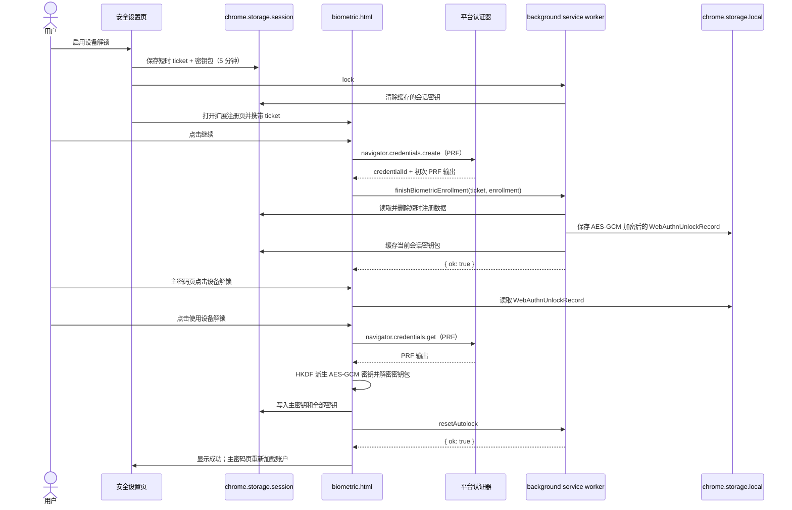

# WebAuthn 设备解锁实现说明

本文记录 Authenticator 浏览器扩展中的平台认证器（设备解锁）实现，面向维护代码、排查注册问题和扩展测试的开发者。实现入口主要在 `src/models/biometric-unlock.ts`、`src/models/biometric-window.ts`、`src/biometric.ts`、`src/background.ts` 和 `src/components/Popup/SetPasswordPage.vue`。

## 1. 目标与边界

- 用设备平台认证器解锁本地密码库；用户验证由操作系统/浏览器处理，可使用生物识别或设备 PIN，具体方式由平台决定。
- 不替代主密码。主密码仍是兼容及恢复路径。
- 认证器只用于派生本次解锁的密钥材料；扩展不会读取或保存指纹、面容等生物特征数据。
- WebAuthn 只在 Chromium 系列浏览器、WebAuthn API 可用且平台用户验证认证器可用时提供。界面还要求已有默认加密密钥。

## 2. 模块职责

| 文件                                         | 职责                                                                                             |
| -------------------------------------------- | ------------------------------------------------------------------------------------------------ |
| `src/models/biometric-unlock.ts`             | WebAuthn 能力检测、凭据注册/断言、密钥包校验、PRF 派生、AES-GCM 加解密、持久记录与 session 缓存  |
| `src/models/biometric-window.ts`             | 以独立小窗口（`type: "popup"`、聚焦）打开注册/解锁页，在窗口关闭时回调刷新入口状态                |
| `src/biometric.ts`                           | `view/biometric.html` 注册/解锁页面；注册时在点击的同步调用链中启动 WebAuthn，解锁带 `auto=1` 时自动触发断言，成功后自动关闭 |
| `src/background.ts`                          | 校验扩展内部消息发送方与数据，完成注册、设置自动锁定闹钟、响应 `lock` / `resetAutolock`          |
| `src/store/Accounts.ts`                      | 从 `chrome.storage.session` 恢复默认密钥和多版本密钥，初始化账户加密状态                         |
| `src/components/Popup/SetPasswordPage.vue`   | 安全设置页入口；建立短时注册票据、锁定当前会话并打开注册页                                       |
| `src/components/Popup/EnterPasswordPage.vue` | 主密码页中的设备解锁入口；记录存在时在弹窗内直接断言（无窗口），手动点击时走小窗口兜底       |

## 3. 注册与解锁时序



### 注册关键步骤

1. `SetPasswordPage.enableBiometricUnlock()` 从 Vuex 的 `encryption` Map 和 `defaultEncryption` 创建 `BiometricUnlockBundle`。
2. `stageBiometricBundleForCreation()` 把 bundle 与随机 ticket 暂存于 `chrome.storage.session`，到期时间为 5 分钟。随后安全设置页请求后台锁定当前会话，并通过 `openBiometricWindow()` 打开 `view/biometric.html?ticket=...` 独立小窗口（`chrome.windows.create`，`type: "popup"`、`focused: true`）。窗口位置用 `chrome.windows.getLastFocused({})` 取当前浏览器窗口几何后算出，贴在右上角工具栏下方；拿不到几何时退回浏览器默认位置。不要改用后台标签页：WebAuthn 需要窗口聚焦，否则平台认证器提示会被浏览器抑制。
3. 注册页的按钮处理器直接调用 `beginBiometricCredentialEnrollment()`。不要在 `navigator.credentials.create()` 之前插入新的异步等待或脱离点击手势，否则浏览器可能拒绝 WebAuthn 请求。
4. 注册请求指定平台认证器、resident key 和 required user verification，并请求 PRF 扩展。请求中只设置 RP 名称，不显式覆盖 RP ID；不要随意加入 `rp.id`。
5. 页面把 credential ID、扩展 ID、盐和初次 PRF 输出传给后台。后台检查消息发送方是本扩展、扩展 ID 匹配、数据格式有效，并消费一次性 ticket。
6. 后台用初次 PRF 输出加密完整密钥包，把记录保存到 `chrome.storage.local`，并将本次会话密钥写入 `chrome.storage.session`。注册成功后设置自动锁定闹钟。

### 解锁关键步骤

1. 主密码页从 `chrome.storage.local` 检查是否存在与当前扩展 ID 匹配的有效记录。存在时**在弹窗内直接**执行断言（`unlockInline()`），不打开任何窗口，用户只会看到系统设备提示。
2. `navigator.credentials.get()` 限定允许的 credential ID，并请求该凭据对记录中 PRF 盐的输出。
3. 由 PRF 输出重新派生包装密钥，AES-GCM 解密并校验 bundle。
4. `cacheBiometricUnlockBundle()` 直接写入 session storage；随后提交 `accounts/applyCachedKeys` 把密钥注入 Vuex，再发送 `resetAutolock` 由后台清除并重新设置闹钟，最后 `style/hideInfo` 让列表重新显示。
5. 手动点击「使用设备解锁」同样走内联断言（点击本身带来用户手势），不会打开小窗口。只有当浏览器直接拒绝提示（`NotAllowedError` 且耗时小于 600ms，说明提示根本没出现）时，才回退到 `view/biometric.html?mode=unlock&auto=1` 小窗口重试一次（窗口内自动断言，失败才要求再点一次）。

### 自动触发的边界

- 内联断言没有用户手势，Chrome 可能直接拒绝（`NotAllowedError`）。此时不弹窗、不报错，保持密码页并显示「使用设备解锁」按钮，同时写入 `AuthenticatorBiometricAutoPromptSkippedUntil`（2 分钟），避免每次打开都重试。
- 手动点击被用户取消（`NotAllowedError` 但耗时较长）时，页面显示「已取消设备解锁」，不打开窗口。
- 若弹窗在系统设备提示出现时被浏览器关闭，断言会随上下文一起中断，结果就是「什么都没发生」。这种情况需要退回窗口流程。
- 解锁成功或用户手动点按钮时清除跳过标记。
- `biometric.html?auto=1` 的自动断言分支保留作为窗口内兜底，但主密码页默认不再使用它。

## 4. 数据结构与密钥派生

### `BiometricUnlockBundle`（仅解密后使用）

```ts
{
  version: 1,
  defaultKeyId: string,
  keys: Array<{ id: string; secret: string }>
}
```

bundle 保存账户数据使用的当前及历史加密密钥。校验要求至少一个 key、最多 32 个、ID 非空且唯一，并且 `defaultKeyId` 必须指向其中一个 key。不要把这个明文 bundle 写入 `chrome.storage.local`。

### `WebAuthnUnlockRecord`（持久化）

存储键为 `AuthenticatorBiometricUnlock`，字段如下：

| 字段           | 说明                                            |
| -------------- | ----------------------------------------------- |
| `version`      | 当前记录版本 `1`                                |
| `extensionId`  | 所属扩展 ID；读取及使用时必须与当前运行扩展一致 |
| `credentialId` | 平台认证器生成的 credential ID，base64url       |
| `prfSalt`      | PRF 输入盐，32 字节，base64url                  |
| `kdfSalt`      | HKDF 盐，32 字节，base64url                     |
| `iv`           | AES-GCM 随机 nonce，12 字节，base64url          |
| `ciphertext`   | AES-GCM 密文及认证标签，base64url               |

密钥包序列化为 UTF-8 JSON。包装算法：

1. 将 32 字节 WebAuthn PRF 输出导入 HKDF。
2. 使用 HKDF-SHA-256、随机 32 字节 `kdfSalt` 和上下文字符串 `Authenticator local vault unlock key v1` 派生 AES-256-GCM 密钥。
3. AES-GCM 使用随机 12 字节 IV。AAD 为 `version|extensionId|credentialId|prfSalt|kdfSalt`，将记录元数据与密文绑定。
4. 解密后仍需通过 bundle 结构校验。错误 PRF 或密文/元数据篡改应由 GCM 认证失败拒绝。

### 临时与会话存储

- 注册临时键前缀：`AuthenticatorBiometricSetup:` + ticket。值中含待加密 bundle 明文和过期时间，生命周期 5 分钟；完成时先移除再校验消费，取消时移除。
- `chrome.storage.session` 中的 `cachedPassphrase`、`cachedKeyId`、`cachedBiometricKeys`、`cachedBiometricDefaultKeyId` 是解锁后的会话缓存，不是持久凭据。扩展锁定时清空这些值。
- 会话密钥包缓存只通过 `chrome.storage.session.set()` 写入。不要在 background service worker 中用 `chrome.runtime.sendMessage()` 向自身投递缓存消息；MV3 service worker 不应依赖该自消息回环完成状态更新。

## 5. 安全与兼容要求

- WebAuthn 必须在安全上下文和真实用户操作中执行。用户取消、API 拒绝、缺少 PRF 输出、ticket 超时或密钥包校验失败都必须回到主密码可用状态。
- 仅接受 32 字节 PRF 输出；注册时还要求 `prf.enabled === true`。不能把“认证器存在”当作“PRF 已成功提供”。
- 后台对 `finishBiometricEnrollment` 校验发送方 URL 属于当前扩展，且 enrollment 的 `extensionId` 与 `chrome.runtime.id` 一致；不信任页面传来的 ticket、credential ID 或密钥数据。
- 永久记录不包含密钥包明文，也不保存 PRF 输出。PRF 输出只在本次注册/解锁调用及交给后台完成加密时短暂存在。
- Chrome/Edge 等 Chromium 浏览器具有扩展页面 WebAuthn 支持时才显示相关设置；Firefox 与 Safari 不显示此功能。
- 自定义或调试构建的扩展 ID 会影响 extension origin 与记录绑定。测试环境需固定 manifest key / extension ID，不能把一个扩展的记录复制给另一个 ID。
- 关闭设备解锁时删除持久记录和 session 中的生物识别密钥缓存；主密码与 OTP 数据本身不因此删除。

## 6. 修改代码时的注意事项

- 变更 record 字段、加密算法、PRF context 或版本号时，必须考虑已有用户记录的迁移/失效策略；不得静默破坏现有凭据。
- 保持注册和断言使用相同的 `prfSalt`；解密使用记录中的 `kdfSalt` 和 AAD 元数据。
- 新增背景消息时同时更新 `RuntimeMessage` 类型、`isRuntimeMessage()` 校验、发送端和错误响应处理。
- 修改 session 密钥状态时检查 `Accounts.getModule()` 与 `getCachedBiometricKeys()` 的恢复路径，并保留锁定清理与 autolock 行为。
- 不要将 session cache helper 改回 background 自消息传递；设备解锁路径需直接存储缓存并单独请求 `resetAutolock`。
- 窗口位置是有意为之：贴当前浏览器窗口右上角、工具栏下方（`biometric-window.ts` 里的 `ANCHOR_MARGIN` / `TOOLBAR_OFFSET`）。不要改成屏幕居中或系统默认位置，也不要在打开后再次 `chrome.windows.update` 移动它。

## 7. 验证

项目有浏览器驱动的 Mocha 测试，常规命令：

```sh
npm run pretest
npm test
```

`pretest` 构建 Chrome/Firefox 测试扩展，`npm test` 通过 Puppeteer 启动 Chrome 执行扩展测试页。生物识别密钥包装相关测试位于 `src/test/models/biometric-unlock.test.ts`，覆盖密钥包往返、密文篡改/错误 PRF 拒绝、密钥包结构校验和 session 直接缓存。

真实注册/解锁冒烟测试需在支持 WebAuthn PRF 的 Chromium 环境与平台认证器上执行。自动化环境可使用 Chromium CDP WebAuthn virtual authenticator（需支持 resident key、user verification 和 PRF），检查：

1. 注册页能成功创建凭据，记录写入 `chrome.storage.local`。
2. 锁定会话后，解锁页可对同一凭据生成 PRF 输出并恢复正确密钥包。
3. 解锁后 session storage 中出现 `cachedPassphrase` 和 `cachedBiometricKeys`，后台设置 autolock 闹钟。
4. 错误 PRF、篡改密文、无效/过期 ticket、取消 WebAuthn 都不会显示成功或遗失主密码恢复路径。

格式化和生产构建可分别运行 `npm run format:check` 与 `npm run prod`。生产构建体积警告应与 WebAuthn 逻辑正确性分开判断。
